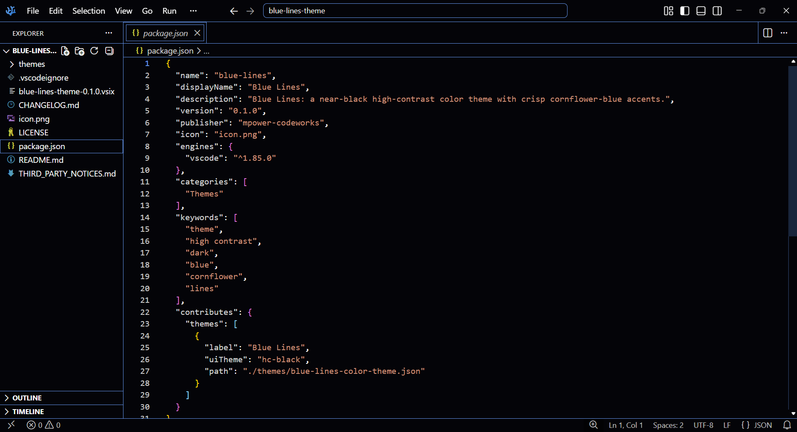
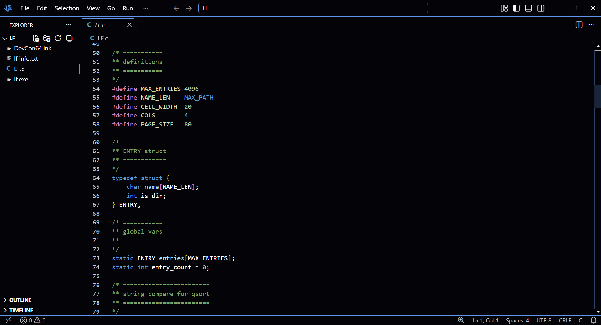

<!--Blue Lines is a dark, high-contrast VS Code color theme
using near-black surfaces and vivid blue borders.-->
𝖡𝗅𝗎𝖾 𝖫𝗂𝗇𝖾𝗌 𝗂𝗌 𝖺 𝖽𝖺𝗋𝗄, 𝗁𝗂𝗀𝗁-𝖼𝗈𝗇𝗍𝗋𝖺𝗌𝗍 𝖵𝖲 𝖢𝗈𝖽𝖾 𝖼𝗈𝗅𝗈𝗋 𝗍𝗁𝖾𝗆𝖾
𝗎𝗌𝗂𝗇𝗀 𝗇𝖾𝖺𝗋-𝖻𝗅𝖺𝖼𝗄 𝗌𝗎𝗋𝖿𝖺𝖼𝖾𝗌 𝖺𝗇𝖽 𝗏𝗂𝗏𝗂𝖽 𝖻𝗅𝗎𝖾 𝖻𝗈𝗋𝖽𝖾𝗋𝗌.
<br><br>

<!--
Its syntax colors are based on VS Code's built-in
**Default High Contrast** theme.
-->
𝖨𝗍𝗌 𝗌𝗒𝗇𝗍𝖺𝗑 𝖼𝗈𝗅𝗈𝗋𝗌 𝖺𝗋𝖾 𝖻𝖺𝗌𝖾𝖽 𝗈𝗇 𝖵𝖲 𝖢𝗈𝖽𝖾'𝗌 𝖻𝗎𝗂𝗅𝗍-𝗂𝗇
𝖣𝖾𝖿𝖺𝗎𝗅𝗍 𝖧𝗂𝗀𝗁 𝖢𝗈𝗇𝗍𝗋𝖺𝗌𝗍 𝗍𝗁𝖾𝗆𝖾.
<br><br>

```
- Background:         #040408
- Accent and borders: #6495ED
- Interface text:     #C8C8C8
- Selection:          #324A76
- Scrollbar:          #19253B
```
<table>
    <tr>
        <td align="left" width="50%" valign="top">
            <br>
        </td>
        <td align="left" width="50%" valign="top">
            <br>
        </td>
    </tr>
</table>

𝖳𝗁𝖾 𝗈𝗋𝗂𝗀𝗂𝗇𝖺𝗅 𝗌𝗒𝗇𝗍𝖺𝗑-𝖼𝗈𝗅𝗈𝗋 𝗋𝗎𝗅𝖾𝗌 𝗐𝖾𝗋𝖾 𝗍𝖺𝗄𝖾𝗇 𝖿𝗋𝗈𝗆 𝖬𝗂𝖼𝗋𝗈𝗌𝗈𝖿𝗍'𝗌 𝖵𝖲 𝖢𝗈𝖽𝖾 *𝖣𝖾𝖿𝖺𝗎𝗅𝗍 𝖧𝗂𝗀𝗁 𝖢𝗈𝗇𝗍𝗋𝖺𝗌𝗍* 𝗍𝗁𝖾𝗆𝖾 (`𝗁𝖼_𝖻𝗅𝖺𝖼𝗄.𝗃𝗌𝗈𝗇`), 𝖽𝗂𝗌𝗍𝗋𝗂𝖻𝗎𝗍𝖾𝖽 𝗎𝗇𝖽𝖾𝗋 𝗍𝗁𝖾 𝖬𝖨𝖳 𝖫𝗂𝖼𝖾𝗇𝗌𝖾. 𝖲𝖾𝖾 `𝖳𝖧𝖨𝖱𝖣_𝖯𝖠𝖱𝖳𝖸_𝖭𝖮𝖳𝖨𝖢𝖤𝖲.𝗆𝖽`.
